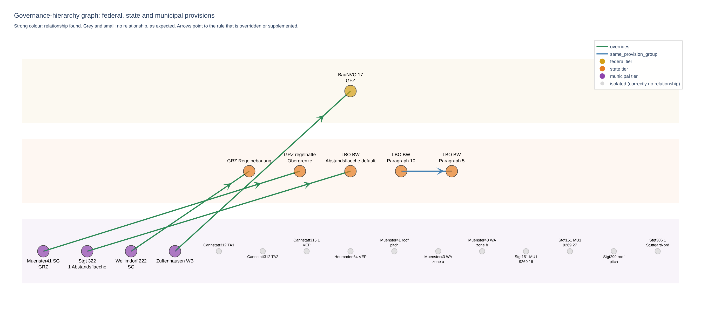
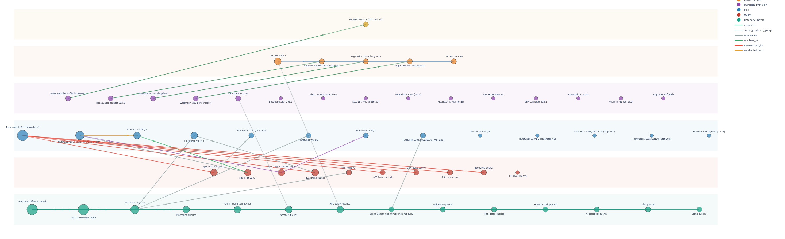

# Which rule overrides which? A governance graph for building regulations

A small experiment: can a local language model read building-regulation text and extract which rule overrides which, across federal, state and municipal law?

**Status: conceptual work, tested on 20 sentences.** The aim was to check one thing: does the model recognise the right type of relationship (overrides, supplements, or none)? It shows that the approach is workable and where it breaks. It does not show that it works on real plan text or at scale.

*The chart from the notebook. Three levels of law from top to bottom. Four municipal plans override a higher rule, and one state paragraph supplements another. The 11 grey provisions stand alone.*

## Why a graph

In German building law, a rule is rarely valid on its own. A federal default applies unless a state rule or a municipal development plan sets something else.

In my M.Sc. thesis on [AI for digital building permitting in Stuttgart](https://github.com/meet-rehman/digital-building-permit-stuttgart), the text layer searched regulation text by similarity. That finds passages on the right topic. It does not know that one passage overrides another. A place name in the question could pull up text about the place instead of the rule that applies.

A graph stores exactly the missing part: provisions as nodes, and "overrides" as an edge between them.

## What I did

1. **Wrote 20 test sentences** in German, each with an expected result. They are modelled on patterns from Stuttgart development plans: real overrides, place-name coincidences, two zones with the same label but different values, plans without a site coverage ratio.
2. **Ran a local model** (qwen2.5:7b through Ollama, on my own workstation) that returns provisions and relationships as JSON in a fixed schema.
3. **Scored the output** automatically against the expected relationship type.
4. **Diagnosed the misses**, added targeted examples to the prompt, and re-ran the failed sentences.
5. **Built the graph** with NetworkX and, in a second version, with TopologicPy, the library used in the eCAADe 2026 workshop on graph analytics that this experiment started from.

## Result

| Run | Correct |
|---|---|
| First pass, 20 sentences | 16 of 20 |
| Retest of the 4 failed sentences, after the prompt fix | 4 of 4 |

The four misses were not random:

| Sentence | Expected | Model returned | Cause |
|---|---|---|---|
| c10: a second value for the same zone label in one plan | no relationship | overrides | The plan only sets its own value. Nothing is being deviated from |
| c17: two sub-areas of one plan with different setbacks | no relationship | overrides | "abweichend" (different) was read as "deviating from a higher rule" |
| c15: the federal default, "unless a plan sets otherwise" | no relationship | overrides | A general description of how overrides work was read as one specific override |
| c12: paragraph 10 supplements paragraph 5 | same provision group | no relationship | The two paragraph numbers were merged into one entity, so nothing was left to link |

Three of the four are the same mistake: **the model reacted to override-sounding words without checking that a baseline rule was actually named.** This is the pattern I had already found in the thesis, where text retrieval reacted to a place name without checking that the passage was about the rule in question.

## Limits

Read these before using the numbers above.

- **The sentences are constructed.** I wrote them for this test. They are short, clear and in ASCII German. They are not quotations from the plans or from the law, and some simplify the legal content. Real plan text is longer and messier.
- **The retest does not show that the fix generalises.** The examples I added to the prompt are close to the sentences that had failed. Passing them afterwards is expected. The other 16 sentences were not re-run with the new prompt.
- **The test is about relationship types.** Whether the model named the correct source and target was outside its scope and is not scored. In the raw output the endpoints are not always right. See `results/first_pass_results.jsonl`.
- **The graph files were cleaned by hand.** `data/nodes.csv` and `data/edges.csv` are my tidied version of the model output, with consistent names. They are not raw model output.
- **20 sentences, one model, one run.** No repeated runs, no second model for comparison.

## A second graph: the thesis findings as one structure

*Rows from top to bottom: federal, state and municipal provisions, land plots, benchmark queries, and failure patterns. Built with TopologicPy.*

In a second step I put the findings of my thesis benchmark into one graph: 58 nodes and 36 edges. The node types are provisions, plots, queries, query categories and failure patterns.

Seen as a graph, two failure patterns become hubs:

- **Road parcels.** Six queries about different plots all resolved to a road parcel. In a results table these are six separate rows. In the graph they point to one node.
- **Off-topic reports.** The query categories with thin coverage in the corpus connect to the same pattern, a generic report returned in place of an answer.

This graph was assembled by hand from the benchmark results. It is a way of reading the findings, not an output of the extraction model. Only the image is included here, because the benchmark query set is not public.

## Repository

| File | Content |
|---|---|
| [`extract_relationships_local.py`](extract_relationships_local.py) | The extraction script: output schema, prompt, the 20 test sentences, self-scoring |
| [`governance_graph.ipynb`](governance_graph.ipynb) | Builds and draws the graph from the CSV files, with density and centrality |
| [`data/nodes.csv`](data/nodes.csv), [`data/edges.csv`](data/edges.csv) | 21 provisions and 5 relationships |
| [`results/`](results) | Raw model output of the first pass and of the retest |

**To run it:** install [Ollama](https://ollama.com), then `ollama pull qwen2.5:7b` and `pip install ollama pandas networkx plotly`. Run `python extract_relationships_local.py` for the extraction, and open the notebook for the graph. The interactive chart in the notebook does not show in the GitHub preview.

## Next steps

- Run the extraction on real passages from the plans and the statutes, with a test set that is kept apart from the prompt examples.
- Score source and target, not only the relationship type.
- Compare the 7B model with a larger one on the same test set.
- Connect the graph to retrieval: when a passage is found, also fetch what overrides it.

## Context

This is an extension of my M.Sc. thesis at HfWU Nürtingen-Geislingen (2026). The source code of the thesis system and its benchmark query set are private.

Author: Abdul Rehman, [github.com/meet-rehman](https://github.com/meet-rehman)
